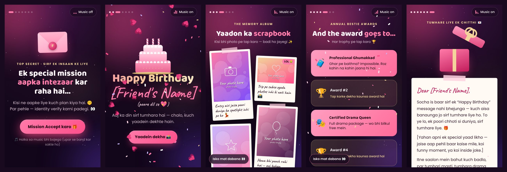

# 🎁 Birthday Surprise Website

A mobile-first, interactive birthday surprise you can send to a friend as a single link. It works like a small story: a secret mission, a funny verification, a cake reveal, a photo scrapbook, awards, a friendship quiz and a final letter.

Plain **HTML + CSS + JavaScript**. No framework, no build step, no backend.



## ✨ Features

| Screen | What happens |
|---|---|
| 1. Secret Mission | Animated envelope, "Mission Accept karo" button, starts background music |
| 2. Verification | 3 funny questions. The **"Nahi"** button shows a new message on every tap (23 in total), then disappears 😄 |
| 3. Cake Reveal | Tap the cake → candles blow out → confetti + "Happy Birthday [Friend's Name]" |
| 4. Scrapbook | Polaroid-style photo gallery with captions, full-screen viewer with swipe |
| 5. Awards | Flip cards with funny personalised awards |
| 6. Friendship Quiz | 4 questions with score, right/wrong reactions |
| 7. Final Gift | Gift box opens → personal letter → "One last secret" → replay |

Also included:
- "Isko mat dabana 👀" secret button
- Music on/off button (an original lofi tune is included)
- Soft sound effects and confetti
- Respects reduced-motion settings
- Self-hosted fonts (Baloo 2, Poppins, Caveat), so nothing is loaded from third-party servers
- Tested on a 390 × 844 phone viewport: no horizontal scroll, no console errors

## 🔧 Yahan changes karne hain (Customize checklist)

Is project mein koi real naam ya personal detail nahi hai. Jahan bhi aapko apni details daalni hain, wahan **`[Square bracket]`** wala placeholder hai, aur code mein **`[CHANGE]`** comment laga hai. Lagbhag saara kaam sirf **`js/data.js`** mein hai.

| # | Kya badalna hai | File → jagah | Abhi kya likha hai |
|---|---|---|---|
| 1 | **Dost ka naam** (website pe har jagah apne aap aa jayega) | `js/data.js` → `name` | `[Friend's Name]` |
| 2 | **Aapka naam** (letter ke neeche, quiz, messages) | `js/data.js` → `from` | `[Your Name]` |
| 3 | **Photos** | `assets/images/` + `assets/thumbs/` | 10 placeholder images: "Your photo here" |
| 4 | **Photo captions** | `js/data.js` → `photos` | Sample funny captions |
| 5 | **Pehli mulaqat wala quiz sawaal** | `js/data.js` → `quiz` (pehla sawaal) | `[Jahan pehli baar mile — sahi jawab]`, `[Galat option 1]`, `[Galat option 2]` |
| 6 | **Letter mein aapki special yaad** | `js/data.js` → `letter` | `[Yahan apni ek special yaad likho …]` |
| 7 | Baaki letter, quiz, awards *(optional)* | `js/data.js` → `letter`, `quiz`, `awards` | Generic sample text |
| 8 | Background music *(optional)* | `assets/audio/music.mp3` | Original lofi tune; apna gaana isi naam se replace karo |

**Tip:** `{name}` aur `{from}` ko mat badalna. Ye apne aap #1 aur #2 se replace ho jaate hain.

Badlav ke baad search karke check karo ki koi placeholder bacha to nahi (VS Code: `Ctrl + Shift + F`, search: `[CHANGE]` aur `[`).

### Photos kaise daalein
1. Apni photos `assets/images/` mein daalo (full size) aur unki chhoti copy (~640 px) `assets/thumbs/` mein, **same file name** ke saath.
2. `js/data.js` ki `photos` list mein har photo ki ek line rakho:
   ```js
   { file: "photo-01.jpg", caption: "Your caption 😄", alt: "Short description" },
   ```
   `funny: true` lagane se photo pe "LOL 😂" tag aata hai. Photos ki koi limit nahi hai.
3. Purani placeholder files (`photo-01.jpg` … `photo-10.jpg`) delete kar do, ya unhi naamon se apni photos rakh do.

## ▶️ Run locally

Double-click `index.html`, or run a local server:
```bash
python -m http.server 8000
```
Then open `http://localhost:8000`. To test on a phone, connect it to the same Wi-Fi and open `http://<your-computer-IP>:8000`.

## 🚀 Deploy (free)

**Netlify:** Add new project → Import from GitHub → select this repo → leave the build command and publish directory empty → Deploy.

**GitHub Pages:** Settings → Pages → Branch `main` / root → Save.

> 🔒 **Privacy tip:** a deployed site is public to anyone with the link. If you use real photos, keep your repo **private**, and make sure the site's visitor access in Netlify is set to public so your friend can open the link without logging in.

## 📁 Structure

```
index.html            page structure (7 screens)
css/styles.css        design and animations
js/data.js            ALL text, names and photo list (edit this)
js/main.js            logic (navigation, quiz, gallery, music, confetti)
assets/images/        full-size photos
assets/thumbs/        small photos for the gallery
assets/audio/         background music
assets/fonts/         self-hosted fonts (SIL Open Font License)
```

The photos in this repo are generated placeholders, so you can replace them freely.
